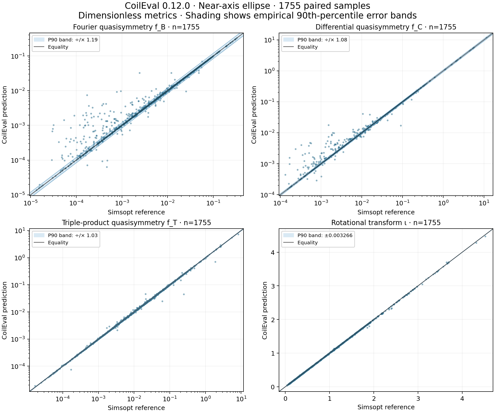

# CoilEval

[简体中文](README.zh-CN.md) · [Install](#installation) · [Example1: evaluate](#example1) · [Example2: optimize](#example2) · [Accuracy and speed](#validation)

CoilEval takes stellarator coil shapes, currents, field-period counts and a target
volume, then estimates magnetic surfaces and computes quasisymmetry and coil
geometry metrics on CPU or NVIDIA GPU. It also provides local parameter gradients.
Coil shapes are Fourier coefficients: sine and cosine terms describing each closed
curve. The target volume selects the enclosed volume of the surface to evaluate.

A local gradient describes how the result changes for small parameter changes
along the selected solution branch. The magnetic axis can move along that branch.
Rotational transform ι is the average poloidal turns per toroidal turn of a field line.

**Version 0.12.0.** The evaluator estimates magnetic surfaces as level sets of a
scalar function `s`. By default it fits `s` first in a circular sampling region
and then in a region bounded by a level set from the first fit.
Set `psi_fit="near_axis_ellipse"` to fit once in a region predicted
from the field close to the magnetic axis. This option supports values and local
gradients on CPU and GPU. `psi_target_refit=True` selects the optional third fit
after the two-fit procedure. See [configuration and limitations](docs/api.md).

<a id="installation"></a>
## Install

Linux x86-64, glibc 2.28+ and Python 3.10+ are supported. A wheel (`.whl`) is a
precompiled Python installation package. See the [source build instructions](docs/installation.md)
to build a wheel from this checkout. Run the examples from the root of the
checkout or extracted source archive.

GPU: install the supplied wheel and CUDA 12.8 runtime dependencies. Example2 also
needs CUDA-enabled PyTorch:

```sh
python -m pip install "./coil_eval-0.12.0-py3-none-manylinux_2_28_x86_64.whl[gpu]"
python -m pip install "torch==2.7.1+cu128" --index-url https://download.pytorch.org/whl/cu128
```

For CPU use, run both commands in the same Python environment. The first selects
the CPU build of PyTorch, which CoilEval uses for linear algebra. The second
installs CoilEval with SciPy and threadpoolctl.

```sh
python -m pip install "torch==2.7.1+cpu" --index-url https://download.pytorch.org/whl/cpu
python -m pip install "./coil_eval-0.12.0-py3-none-manylinux_2_28_x86_64.whl[cpu]"
```

The PyTorch commands above use the verified builds for Python 3.10–3.13. GPU
operation needs a compatible NVIDIA driver. See the [installation guide](docs/installation.md)
for build selection and environment checks.

<a id="example1"></a>
## Example1: read coils and evaluate

From the source archive root, run:

```sh
python examples/example1.py
```

[example1.py](examples/example1.py) directly shows `CoilSet` for the input,
`EvaluationConfig` for the target, and `Evaluator` for computing metrics.
Defaults are CPU, eight threads and 0.3 m³ target volume. Edit `COILS`,
`TARGET_VOLUME`, `FITTING_RADIUS`, `DEVICE` and the other settings at the top.
The fitting radius is in metres; `helicity=(1,0)` selects quasi-axisymmetry,
meaning field strength independent of the toroidal surface angle.

The script prints status, volume/outer-region QS residuals, boundary rotational
transform, normal drift, coil length/gap/curvature, current and elapsed times.
It saves `runs/example1/result.json`. A valid result still needs its accuracy
diagnostics to be assessed.

<a id="example2"></a>
## Example2: screen 32 starts and optimize in one run

The default uses a GPU with CUDA-enabled PyTorch and SciPy. After installation,
run one script:

```sh
python -m pip install scipy
python examples/example2.py
```

[example2.py](examples/example2.py) keeps `N_STARTS`, `NOISE`, `MAX_STEPS`, device
and parameter scales at the top. Edit `objective(metrics)` to try other goals or
weights.
Each Example1 coefficient is perturbed as `c*exp(log(1.01)*z)` with independent
standard-normal z; screening currents stay fixed. The valid candidate with the
lowest objective starts optimization of coefficients and currents.

The objective combines volume QS, rotational transform, coil gap, curvature,
length and normal drift. SciPy BFGS updates a curvature approximation from gradients
provided through the public `TensorEvaluator` and PyTorch interfaces.
**Each screened candidate and each optimizer iteration prints a line** containing
the objective, QS, iota, coil metrics and elapsed time. Final output includes the
stopping reason, final metrics and total time, plus
`runs/example2/optimized_coils.json` and `history.csv`. The stopping reason is
the status returned by SciPy. The output also identifies invalid trial points.

Edit and rerun either script. Change `OUTPUT` to retain multiple runs.
To run either script with a single ellipse fit, set `PSI_FIT="near_axis_ellipse"`
and `TARGET_VOLUME=0.15`. The bundled coils reach 0.3 m³ with two fits. Their
one-fit scalar turns back before that volume, so the ellipse example uses 0.15 m³.
See [all examples](examples/README.md) for batches, gradients, surface metrics and
Simsopt.

<a id="validation"></a>
## Accuracy and speed

On this page, **quasisymmetry (QS)** means that magnetic-field strength depends on one
helical angle in suitable surface coordinates. **QA** is quasi-axisymmetry and **QH**
is quasi-helical symmetry. `nfp` is the number of repeated field periods around the
device; `helicity=(M,N)` selects the angle `Mθ−Nφ`, with poloidal θ around a surface
cross-section and toroidal φ around the device. **Rotational transform ι (iota)** is
the average number of poloidal turns per toroidal turn of a field line. **RMS** is
the square root of a weighted mean of squares; **P90/P95** are the 90th/95th
percentiles. `f_B` measures field-strength Fourier content outside the requested
symmetry; `f_C` is a differential quasisymmetry residual; `f_T` is a triple-product
residual involving field derivatives. All have ideal value zero; comparisons
require matching averaging regions and normalization.


<!-- calibration-and-timings:start -->
The calibration and timings use CoilEval 0.12.0 with `psi_fit="near_axis_ellipse"`.
The calibration evaluates **4096** tasks from 1024 QUASR coil configurations at four perturbation scales.
CoilEval returned all four surface metrics for **2288** tasks, including **1755** pairs with saved Simsopt reference surfaces.



For QS, each band uses the 90th percentile of the larger value divided by the smaller value in each pair.
The ι band uses the 90th percentile of the absolute difference.
[Paired values](docs/assets/ellipse_012/calibration_pairs.csv) · [Calibration record](docs/assets/ellipse_012/calibration.json)

Timings are in **seconds per sample**. The table uses the median of three measured calls after one cold call and one additional warmup.
Batch wall time is divided by batch size. Value + gradient includes evaluation, the objective and one backward pass.
Surface rows use the high-accuracy f_T calculation.

| Interface and metric | Work | CPU 8 threads | CPU 16 threads | CPU 32 threads | RTX 5090 | A100 |
| --- | --- | ---: | ---: | ---: | ---: | ---: |
| Single query / volume f_C | Value | 19.199 | 19.617 | 16.990 | 1.521 | 1.595 |
| Single query / volume f_C | Value + gradient | 34.515 | 26.080 | 21.726 | 1.925 | 2.197 |
| Batch 1 / volume f_C | Value | 20.703 | 31.804 | 15.355 | 1.524 | 1.599 |
| Batch 1 / volume f_C | Value + gradient | 36.780 | 41.358 | 21.204 | 1.919 | 2.060 |
| Batch 2 / volume f_C | Value | 29.227 | 44.451 | 20.620 | 1.302 | 1.348 |
| Batch 2 / volume f_C | Value + gradient | 43.238 | 33.577 | 29.572 | 1.655 | 1.712 |
| Batch 4 / volume f_C | Value | 30.437 | 21.746 | 18.361 | 1.190 | 1.207 |
| Batch 4 / volume f_C | Value + gradient | 46.488 | 51.706 | 26.425 | 1.504 | 1.561 |
| Batch 8 / volume f_C | Value | 27.965 | 22.986 | 20.764 | 1.115 | 1.139 |
| Batch 8 / volume f_C | Value + gradient | 41.240 | 28.933 | 29.357 | 1.699 | 1.607 |
| Single query / surface f_T | Value | 32.389 | 24.841 | 21.671 | 1.766 | 1.754 |
| Single query / surface f_T | Value + gradient | 51.793 | 53.558 | 30.751 | 2.332 | 2.243 |

Timings use eight fixed queries from four coil sets. GPU timings wait for device completion and use eight host threads.
See the [timing records](docs/assets/ellipse_012/timings.json) for hardware and individual calls.
<!-- calibration-and-timings:end -->

## Scope and further documentation

Errors can come from finite-order surface fits, regularization bias, angular
discretization and amplification near resonances. Even smooth Poincare sections
(field-line intersections with fixed cross-sections) can accompany large metric
errors.

- [API, metrics and configuration](docs/api.md)
- [PyTorch gradients and batches](docs/torch.md), [CPU operation](docs/cpu.md)
- [Surface quasisymmetry metrics](docs/qs.md), [Simsopt independent surface solves](docs/simsopt.md)
- [All examples](examples/README.md), [versions](docs/versions.md), [changelog](CHANGELOG.md), [development](docs/development.md)

License: [MIT](LICENSE).
