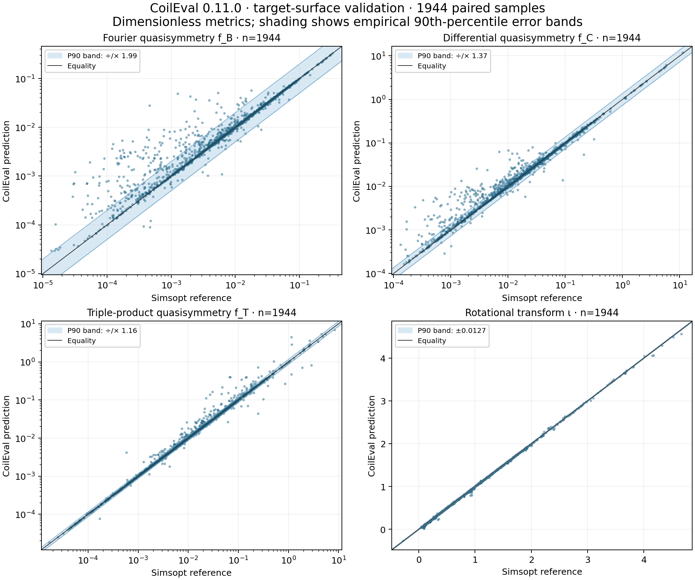

# CoilEval

[English](README.md) · [安装](#installation) · [Example1：求值](#example1) · [Example2：优化](#example2) · [精度与速度](#validation)

CoilEval 根据仿星器线圈的形状、电流、场周期数和目标体积，在 CPU 或 NVIDIA GPU 上
估计磁面、计算磁场准对称性和线圈几何指标，并提供这些指标对线圈参数的局部梯度。
输入形状用 Fourier（傅里叶）系数表示，即用正弦、余弦项描述每条闭合线圈。
目标体积指定要评估的磁面包围多少空间。

局部梯度描述当前参数附近的小幅变化，计算时保持已选中的磁轴和采样分支不变。旋转变换 ι 是磁力线每绕环向一圈平均绕极向的圈数。

**版本 0.11.1，预发布候选。** 默认先拟合磁面标签函数，再在选出的闭合区域内重新拟合。
这两次拟合决定后续磁面和指标；可选的第三次拟合由 `psi_target_refit=True` 开启，默认关闭。

<a id="installation"></a>
## 安装

支持 Linux x86-64、glibc 2.28+、Python 3.10+。wheel（`.whl`）是免本地编译的 Python 安装包；
源码压缩包另含下面的 `examples/` 脚本。**先解压源码包，再在其根目录运行示例。**

GPU：安装随附 wheel 和 CUDA 12.8 运行库。Example2 还需要 CUDA 版 PyTorch：

```sh
python -m pip install "./coil_eval-0.11.1-py3-none-manylinux_2_28_x86_64.whl[gpu]"
python -m pip install torch==2.7.1 --index-url https://download.pytorch.org/whl/cu128
```

CPU：在同一个 Python 环境中依次执行。第一条明确选择 CPU 版 PyTorch；`[cpu]` 这个依赖组名字
本身不会让 pip 自动选择 CPU 版 Torch。CPU 求值也使用 Torch 的线性代数功能。

```sh
python -m pip install "torch>=2.5" --index-url https://download.pytorch.org/whl/cpu
python -m pip install "./coil_eval-0.11.1-py3-none-manylinux_2_28_x86_64.whl[cpu]"
```

GPU 需兼容的 NVIDIA 驱动；纯 CPU 求值不需要 CUDA。环境、可选依赖与源码构建见[安装指南](docs/installation.zh-CN.md)。

<a id="example1"></a>
## Example1：读取线圈并求值

在源码包根目录运行：

```sh
python examples/example1.py
```

[example1.py](examples/example1.py) 直接展示 `CoilSet` 读取线圈、`EvaluationConfig` 设置目标、
`Evaluator` 计算指标。默认使用 CPU、8 线程、目标体积 0.3 m³；在文件顶部修改 `COILS`、
`TARGET_VOLUME`、`FITTING_RADIUS`、`DEVICE` 等即可尝试其他输入和设置。
拟合半径以米为单位；`helicity=(1,0)` 选择准轴对称，即磁场强度在磁面坐标中与环向角无关。

运行会打印状态、体积和外层准对称性残差、边界旋转变换、法向漂移、线圈长度/间距/曲率、电流以及耗时，
并保存 `runs/example1/result.json`。`valid` 表示计算得到了可用结果，精度仍应结合诊断判断。

<a id="example2"></a>
## Example2：一次运行筛选 32 个起点并优化

默认使用 GPU，需要 CUDA 版 PyTorch 和 SciPy；安装后只运行一个脚本：

```sh
python -m pip install scipy
python examples/example2.py
```

[example2.py](examples/example2.py) 的 `N_STARTS`、`NOISE`、`MAX_STEPS`、设备和尺度都在文件顶部。
直接修改 `objective(metrics)` 可以更换目标和权重；没有命令行选项、分片文件或预先固定的输入校验值。
脚本对 Example1 的系数施加 `c·exp(ln(1.01)·z)` 扰动，z 为独立标准高斯数；
筛选时电流不变，从 32 个候选中选择有效且目标函数最小的一组，再优化系数和电流。

目标函数结合体积准对称性残差、旋转变换、线圈间距、曲率、长度和法向漂移。
优化使用 SciPy 的 BFGS（利用梯度更新曲率近似的优化方法），梯度由公开的 `TensorEvaluator` 和 PyTorch 提供。
**每个筛选候选打印一行，每个优化迭代打印一行**，包含目标值、QS、ι、线圈指标和耗时；
结尾显示停止原因、最终指标及总耗时，保存 `runs/example2/optimized_coils.json` 和 `history.csv`。
无效试探点会被标明；停止或达到迭代上限不代表物理认证。

两个脚本都可直接编辑后重跑；如需保留多次输出，请修改顶部的 `OUTPUT`。
[全部示例与参数说明](examples/README.zh-CN.md)列出批量、梯度、目标磁面和 Simsopt 用法。
0.11.1 的简明教学目标与旧预发布复现实验不同；旧报告中的优化轨迹单独标为历史验证。

<a id="validation"></a>
## 精度与速度

本页用语：**准对称性（QS）**指磁场强度在合适的磁面角坐标中只依赖一个螺旋角；
**准轴对称（QA）**和**准螺旋对称（QH）**分别是其中的轴对称型和螺旋型。
`nfp` 是绕装置一周重复的场周期数，`helicity=(M,N)` 指所要求的角组合 `Mθ−Nφ`，
θ 为极向角（绕磁面截面），φ 为环向角（绕整个装置）。**ι（iota，旋转变换）**是磁力线
每绕环向一圈平均绕极向的圈数。**RMS**是先求平方的加权平均、再开平方的均方根；
**P90/P95**分别是第 90/95 百分位数。`f_B` 衡量不符合指定对称性的磁场强度傅里叶分量，
`f_C` 是微分形式的准对称性残差，`f_T` 是包含磁场导数的三重积残差；它们的理想值均为零，
比较时必须使用相同的积分区域和归一化。


固定 1024 个 QUASR 线圈数据库输入、四个噪声尺度，共 **4096** 个任务。默认的两次拟合方法
得到 **2127** 个完整评分；与独立磁面优化库 Simsopt 的已保存参考解可配对 **1944** 个，其中 **817** 个满足
原定参考质量门槛。所有大误差点均保留。1981 个完成的参考不重算；无参考样本只计成功率。



图中 QS 条带为 `exp(±P90(|ln(预测/参考)|))`，ι 条带为 `±P90(|预测−参考|)`。
它描述本样本集的误差覆盖范围。QS 全配对的实测倍数依次为 1.986、1.368、1.157；
表格另列易读的相对误差 P90，两者定义不同。

| 样本集 | 数量 | f_B P90 相对误差 | f_C P90 相对误差 | f_T P90 相对误差 | ι P90 绝对误差 |
| --- | ---: | ---: | ---: | ---: | ---: |
| 全部配对 | 1944 | 93.86% | 34.67% | 15.20% | 0.01270 |
| 参考质量合格 | 817 | 87.04% | 30.17% | 12.17% | 0.01015 |

以下全部单位为 **秒/样本**：一次冷调用和一次额外预热后，计时三次完整调用，取中位数，批量调用再除以批大小。
“求值＋梯度”包含完整目标的一次反传。批量均摊耗时反映吞吐，单样本响应延迟见“单点”行。

| 接口 / 指标 | 模式 | CPU 8 线程 | CPU 16 线程 | CPU 32 线程 | RTX 5090 | A100 |
| --- | --- | ---: | ---: | ---: | ---: | ---: |
| 单点 / 体积 f_C | 求值 | 22.922 | 18.195 | 15.938 | 1.775 | 1.911 |
| 单点 / 体积 f_C | 求值＋梯度 | 40.000 | 28.481 | 21.838 | 2.168 | 2.397 |
| 批量 1 / 体积 f_C | 求值 | 22.843 | 20.695 | 15.847 | 1.785 | 1.915 |
| 批量 1 / 体积 f_C | 求值＋梯度 | 42.364 | 29.731 | 22.055 | 2.159 | 2.410 |
| 批量 2 / 体积 f_C | 求值 | 31.186 | 29.588 | 20.676 | 1.502 | 1.606 |
| 批量 2 / 体积 f_C | 求值＋梯度 | 50.412 | 38.103 | 26.830 | 1.572 | 1.823 |
| 批量 4 / 体积 f_C | 求值 | 30.449 | 25.305 | 19.715 | 1.347 | 1.453 |
| 批量 4 / 体积 f_C | 求值＋梯度 | 47.093 | 33.554 | 25.651 | 1.418 | 1.633 |
| 批量 8 / 体积 f_C | 求值 | 30.669 | 24.617 | 19.702 | 1.296 | 1.396 |
| 批量 8 / 体积 f_C | 求值＋梯度 | 47.288 | 49.192 | 34.473 | 1.375 | 1.547 |
| 单点 / 磁面 f_T | 求值 | 36.701 | 28.010 | 26.115 | 2.024 | 2.057 |
| 单点 / 磁面 f_T | 求值＋梯度 | 56.714 | 40.632 | 34.375 | 2.585 | 2.584 |

CPU 8 线程与 GPU 数据实测于 2026-11-05，CPU 16/32 线程补测于 2026-11-06；数值配置、输入和计算库一致。
CPU 三档均使用 Xeon Gold 6530 的逻辑线程，GPU 每项分配八个主机线程。四组保留到 16 阶的傅里叶线圈形成八个固定查询。
测试使用调度器分配的 CPU，未独占整机；增加线程不保证每项都加速，表中保留全部实测结果。体积 f_C 和附加目标面 f_T 分开列出；
冷启动、整批总时间、硬件及哈希保留在[计时原始证据](docs/assets/preview_s2_20261105/timings.json)。
样本定义、失败分母、参考质量与数值限制见[完整验证记录](docs/preview_validation.zh-CN.md)。


## 使用范围与更多文档

准对称性误差可能来自有限阶磁面拟合、正则化偏差、角坐标离散以及共振附近的误差放大。
光滑的庞加莱截面（磁力线穿过固定截面的位置图）也可能对应较大的指标误差。
历史预发布两例的独立物理检查保留残余力和参考磁面质量限制；详情见[验证报告](docs/preview_validation.zh-CN.md)。

- [API、指标与配置](docs/api.zh-CN.md)
- [PyTorch 梯度和批量求值](docs/torch.zh-CN.md)、[CPU 运行](docs/cpu.zh-CN.md)
- [目标磁面的准对称性指标](docs/qs.zh-CN.md)、[Simsopt 独立磁面求解](docs/simsopt.zh-CN.md)
- [全部示例](examples/README.zh-CN.md)、[版本](docs/versions.zh-CN.md)、[更新日志](docs/changelog.zh-CN.md)、[开发说明](docs/development.zh-CN.md)

许可证：[MIT](LICENSE)。
