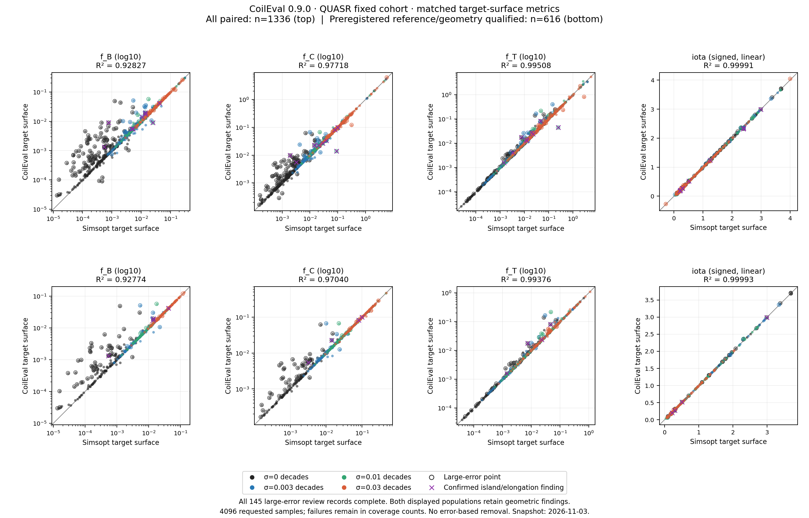
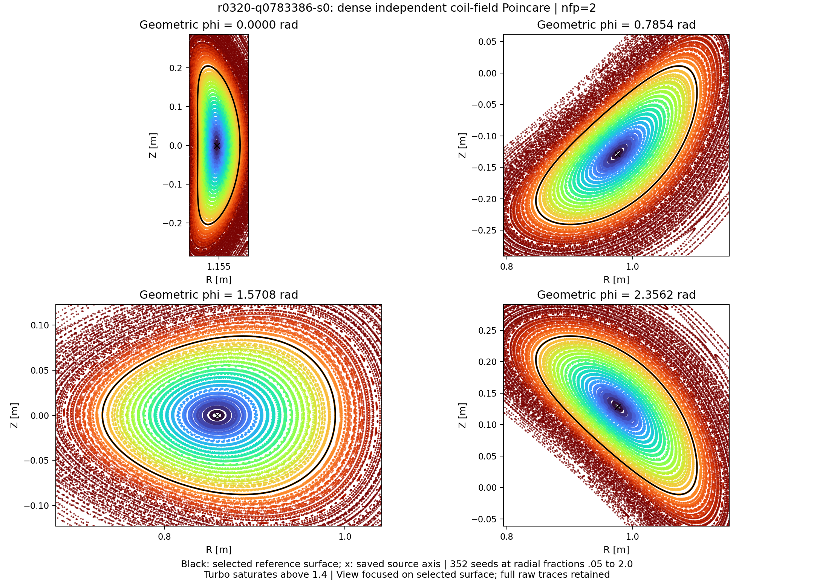
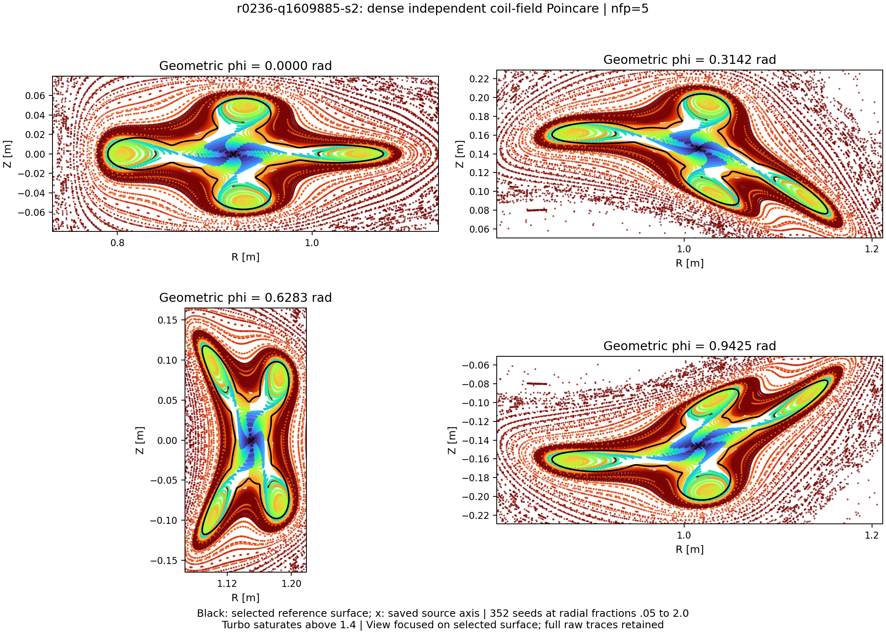
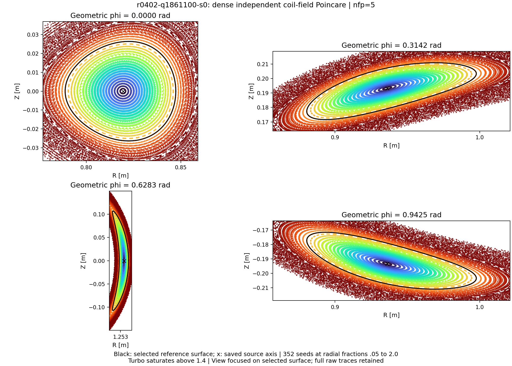

# Preview validation experiments

The 2026-11-03 validation campaign uses a frozen installed CoilEval 0.9.0
runtime. The package remains unreleased. The campaign covers a fixed QUASR
accuracy cohort, public API latency, a reconstructed QA optimization result,
and a simple-ring initialization experiment. Source and library hashes in
each experiment's manifest identify the measured runtime.

## Fixed accuracy cohort: reviewed results

The cohort contains 1024 IDs sampled uniformly without replacement from the
371701-entry QUASR catalog, using seed `2026110201`, without restricting coil
count, field periods or QS type. Every ID has four perturbation scales:
0, 0.003, 0.01 and 0.03 decades, for 4096 evaluation tasks. Each Fourier
coefficient and coil current is independently multiplied by `10**(sigma*z)`,
where `z` is a standard normal draw; zero coefficients remain zero. The target
volume is half the stored outer reference volume. The source-radius multiplier
is 3.5 and the initializer uses the high-precision `reference` profile.

Base GPU and CPU calculations have finished, including recorded failures.
Of 4096 requested tasks, 1981 have completed Simsopt references; 1336 have
paired CoilEval/reference results and 616 of those satisfy the preregistered
reference qualifications. The table gives the reviewed 2026-11-03 results.
Both primary populations retain every large error. The secondary
evidence-filtered population removes four confirmed nearby-island cases from
the reference-qualified set. Accuracy comparisons
use target-surface iota and matched surface definitions and weights for
f_B, f_C and f_T. The shared comparison kernel uses the RMS asymmetric
Boozer Fourier-energy fraction for f_B and `|G|/B²` flux-shell RMS weighting
for f_C and f_T. f_C uses the declared vacuum local residual with each
sample's explicit helicity; f_T uses the same `R²*T/B⁴` normalization length
on both surfaces. This validates CoilEval surfaces and fields against the
independent Simsopt solve and field calculation; it does not independently
validate two separately implemented QS formulas.

| Population | Pairs | log₁₀ f_B R² | log₁₀ f_C R² | log₁₀ f_T R² |
| --- | ---: | ---: | ---: | ---: |
| All paired | 1336 | 0.928267 | 0.977176 | 0.995077 |
| Reference-qualified | 616 | 0.927736 | 0.970397 | 0.993762 |
| Geometry-evidence-filtered (secondary) | 612 | 0.927790 | 0.970548 | 0.994189 |

Reference qualification requires strict Simsopt residual quality, resolved
geometric sections with maximum arc-length-weighted covariance axis ratio at
most 5, and target iota at least 0.01 from rationals with denominator at most 8.
All three QS metrics must pass the 97-to-129 surface-grid check (absolute
tolerance 1e-10 plus 2% relative tolerance), and the 512-to-1024 coil-quadrature
field check requires relative vector L2 at most 1e-3. Surface order remains
fixed at 16; convergence with surface order was not established. Rational
proximity is a qualification rule and alone does not establish an island chain.

R² is `1 - sum((prediction-reference)^2) / sum((reference-mean(reference))^2)`
on log₁₀ QS values, without fitting a regression. Signed target-surface iota
uses the linear scale: all-paired R² is 0.99991166 and RMSE is 0.006556.
The secondary population's signed-iota RMSE is 0.005758.
The zero-noise stratum has 385 pairs and f_B log₁₀ R² of 0.744453;
the pooled QS agreement does not describe that stratum's accuracy.

The upper row shows all 1336 pairs and the lower row shows the 616
reference-qualified pairs. QS axes are logarithmic and signed iota axes are
linear; the diagonal indicates equality. Outlined points mark large errors and
purple crosses mark confirmed island or elongation findings. Both plotted
populations retain these points; the 612-pair secondary result is in the table. A [PDF copy](assets/preview_validation_20261103/calibration_scatter.pdf)
and [figure provenance](assets/preview_validation_20261103/calibration_figure_receipt.json)
are available.

All 145 flagged cases have review outcomes: 144 received four-cut visual
inspection and one failed the geometric-section guard before tracing. Of the
visual cases, 130 show no resolved island chain, seven show nearby islands,
two have elongated sections, four have insufficient trace coverage and one
has unresolved outer morphology. The six unresolved cases, including the
unavailable geometry, receive no geometry exclusion. Four of the seven
nearby-island cases belonged to the 616 reference-qualified pairs; only these
four are removed from the secondary comparison. The two elongated cases
already failed the preregistered reference qualification. A completed review
does not certify valid geometry or uniquely explain a metric error.

The requested denominator remains 4096: 1981 completed Simsopt references,
181 reference rejections, 16 reference timeouts and 1918 native failures
without a reference. The 2115 tasks without completed references cannot enter
accuracy comparisons. Failures, qualifications and geometry labels retain
their task identities and reasons; no point is removed solely for its error.
Frozen raw inputs and completed Simsopt references are available for reuse.
Subsequent revisions verify the freeze manifest and rerun CoilEval and
analysis. New references for previously uncovered tasks require a separately
versioned extension rather than silently changing the frozen baseline.

The protocol is
`coileval090-all-quasr-1024-four-noise-matched-surface-20261102-v1`.
Evidence in the parent validation workspace is under
`evaluation/coileval_preview_20261102/calibration/`: `config.template.json`,
`frozen_inputs/{manifest,selection,input_inventory,delivery}.json`, and
`poincare_execution_20261103/required_reviews.json`. Reviewed statistics,
compact 4096-row plotting input, visual-review accounting and analysis/reference
receipts are in
`results_20261103/{summary,paired_metrics,review_summary,analysis_receipt,freeze_receipt}.json`.
The finalizer verified all 39671 frozen-file hashes before and after analysis;
Simsopt was not rerun. The dated initial statistics remain under
`results_20261103/attempts/before_final_geometry_review/`.

## Poincaré geometry checks

The frozen anomaly review traces eight poloidal starts at each of radial
fractions 0.9, 1.0 and 1.1. This is a **target-neighborhood diagnostic**. Its
review queue contains QS discrepancies above a factor of 2 or iota absolute
errors above `max(0.01, 0.02*abs(reference_iota))`. These triggers request
inspection; every such point remains in the primary accuracy populations.
A nearby island-chain label requires resolved separated closed lobes, and an
elongated-surface label requires the declared covariance axis ratio above 5.
Incomplete coverage and unresolved outer morphology remain inconclusive.

The following general illustrations use separate dense traces from the
interior through the selected surface to the outer region. Each uses 352
starts: 32 on the reference boundary and 40 radial fractions from 0.05 to 2.0
on eight rays. The FP64 coil-field tracer follows 256 field periods with
256 RK steps per period and 512 coil segments. Four geometric cuts use equal
physical R/Z scale and a viewport extending 20% beyond the reference boundary
span on each side. Black curves mark the selected reference surface; crosses
mark the stored source initializer axis. Turbo colors encode seed radius,
saturating above 1.4. All finite raw traces are retained; the viewport only
limits the displayed region.

`r0320-q0783386-s0` has continuous contours around the selected boundary,
while CoilEval f_B is about 13.1 times the matched Simsopt reference. The
geometric review does not explain this error, and the sample remains in the
accuracy populations. All 352 dense traces complete the requested interval.
[Figure provenance](assets/preview_validation_20261103/poincare_dense_r0320-q0783386-s0.provenance.json).

`r0236-q1609885-s2` resolves multiple island lobes near the selected boundary.
Of 352 dense traces, 330 complete and 22 leave the diagnostic bounds. Its
reference also carries rational-proximity and residual-quality flags. Nearby
islands do not uniquely attribute the metric discrepancy.
[Figure provenance](assets/preview_validation_20261103/poincare_dense_r0236-q1609885-s2.provenance.json).

`r0402-q1861100-s0` has a boundary covariance axis ratio of 5.907882 at its
most elongated cut, above the declared threshold 5. All 352 dense traces
complete. The case illustrates a shape limitation even though nested contours
are visible in this finite diagnostic.
[Figure provenance](assets/preview_validation_20261103/poincare_dense_r0402-q1861100-s0.provenance.json).

The dense protocol is `coileval-dense-full-style-poincare-20261103-v1`.
Its same-quadrature Simsopt field comparisons have relative vector L2 below
6e-16 at 32 test points. Controls trace 24 starts for 32 periods while doubling
RK resolution and coil segments. In the island case, RK refinement has a
maximum common-finite point difference of 0.246551 m despite a p95 of
4.38e-9 m; individual outer trajectories are sensitive to integration
resolution. These finite diagnostics do not certify global nested topology.
The frozen references are unchanged. Raw traces, controls and provenance
remain in the parent workspace's
`calibration/dense_execution_20261103/` manifest and registered remote root.
The static figures here are the requested documentation exception to the
ordinary raw-data/on-demand report policy.

## Public API timing workload

The benchmark measures a fixed eight-query workload. It uses the frozen
two-stage configuration and preserves all 16 Fourier orders of four original
QUASR QH coil sets: IDs 1916221, 2485714, 1631665 and 1631494, each with
`nfp=4`, four base coils and 400 physical parameters. Targets are 0.25 and
0.5 of each stored reference volume, with one explicit `EvaluationConfig`
per query. Batch sizes use prefixes of this ordered workload. These are
latencies for the established throughput workload; the random QUASR
calibration experiment measures population accuracy separately.

The matrix has CPU8, RTX 5090, and A100 allocations. Each allocation uses
eight assigned logical CPUs. It records a scalar call and public batches B1, B2,
B4, and B8, for pure value and complete value plus one engineering-inclusive
scalar loss gradient. The gradient includes the QS volume, boundary iota,
normal-drift quality, coil gap, curvature, length, and surface-volume terms;
optional surface-QS scores are separate metrics. Source-fit sharing is disabled,
including repeated coils at two target volumes. GPU batch-axis preparation and
the public pipeline remain enabled.

Every result is a fresh process. The first synchronized public call is labeled
`cold`, one or more untimed calls are labeled `warmup`, and three synchronized
calls are labeled `measured`. The timed wall interval includes public forward
work, result completion, the objective and one reverse for gradient mode. Input
loading, imports, constructor setup, allocation, serialization and cleanup are
outside the interval. Batch wall time and wall time divided by batch size are
reported separately; the latter is amortized cost, not scalar latency.

Each JSON record contains source, native library, field library, cohort,
physical-array and configuration hashes, host/device metadata, query status,
cold/warm/measured attempts, and errors. Missing or failed cells remain
explicit in the reducer. Authoritative latency comes from synchronized wall
time around the complete public call.

The runner requires a Slurm allocation and rejects a device whose reported
GPU name does not match the requested RTX 5090 or A100 label. CPU records set
`CUDA_VISIBLE_DEVICES` empty and record `NUMPY_MADVISE_HUGEPAGE=0`, the
process-only setting needed to avoid the documented first-touch confounder.

The CPU allocation has eight logical CPUs from an Intel Xeon Gold 6530 and
uses eight threads with PyTorch 2.7.1+cpu. RTX 5090 uses the same CPU model;
A100-SXM4-80GB uses an Intel Xeon Platinum 8358P host. Both GPU environments
use PyTorch 2.7.1+cu128. The GPU local response uses FP32 field operations and
FP64 psi operations, as recorded by the 0.9.0 API. The timing workload requests
the ordinary volume `f_C` metrics and no optional surface `f_B` or `f_T`.

Each hardware receives one isolated allocation. Its workload cells run in
fresh processes sequentially to avoid competition on the same allocated
device; the three hardware allocations run concurrently. Timing samples
describe these allocations and workloads; cross-hardware ratios also include
their recorded host differences.

## Measured latency

All 30 timing cells completed on 2026-11-03: each has three valid measured
calls after one cold call and one warmup, for 90 measured calls in total.
CPU measurements completed in retry job 128043.
Values below are medians in seconds for the entire call. A batch contains the
number of independent queries shown in its row.

<!-- BENCHMARK_WALL_TABLE -->

| API workload | CPU8 value | CPU8 value + gradient | RTX 5090 value | RTX 5090 value + gradient | A100 value | A100 value + gradient |
| --- | ---: | ---: | ---: | ---: | ---: | ---: |
| Scalar | 22.483 | 42.531 | 1.553 | 1.959 | 1.903 | 2.473 |
| Batch 1 | 22.865 | 41.871 | 1.560 | 1.989 | 1.898 | 2.452 |
| Batch 2 | 63.821 | 99.577 | 2.584 | 2.813 | 3.219 | 3.650 |
| Batch 4 | 121.086 | 192.466 | 4.665 | 5.029 | 5.902 | 6.620 |
| Batch 8 | 245.300 | 385.934 | 9.013 | 9.420 | 11.282 | 12.657 |

<!-- /BENCHMARK_WALL_TABLE -->

For batch 8, the amortized value/value-plus-gradient costs are 1.127/1.178
seconds per query on RTX 5090 and 1.410/1.582 seconds per query on A100.
The cold call and constructors have separate fields in the raw records;
the table above contains warm public-call latency.

The protocol is `coileval-preview-public-api-benchmark-20261102-v1`.
The parent validation workspace retains the hash-pinned plan, cohort receipt,
raw JSON records, reducer output and audit under
`evaluation/coileval_preview_20261102/benchmark/`. CPU's first attempt used
an environment missing `threadpoolctl` and stopped before a timed physical
call; the retry uses the existing CPU environment and retains the failed
attempt as evidence.

## Example 1: QA BFGS result with independent reference

Task `n3-QA-i0-l5-s2-v5` was selected from 12 historical candidates satisfying
`Ap < 9` and DESC boundary `f_C < 0.01`. The frozen configuration has `nfp=3`,
four base coils and QA helicity `(1,0)`; the selected trajectory is
`w2-t00000182`, iteration 397. Its objective targets are iota 0.47, coil gap
0.1 m, maximum curvature 6 m⁻¹, mean coil length 3.5 m and volume 0.3 m³.
These engineering targets are soft: the selected gap is 0.099124 m, maximum
curvature 6.109613 m⁻¹ and mean length 3.535930 m.

The 2026-11-03 reference evaluation completed source psi → alpha → nu →
standard Simsopt least-squares/Newton → diagnostics → DESC. The reference
profile uses FP64, order-16 Simsopt surfaces and a GPU DESC solve with
`L=M=N=12`, at most 300 iterations and `ftol=xtol=gtol=1e-10`.

| Quantity | Result | Definition or scope |
| --- | ---: | --- |
| Volume-equivalent Ap | 8.4326 | `R_axis_mean / sqrt(V / (2*pi²*R_axis_mean))`, final Simsopt surface |
| Actual surface volume | 0.300000011 m³ | Final Simsopt surface |
| Target-surface iota | 0.469986190 | Final Simsopt surface |
| Simsopt surface f_C | 0.008162690 | CoilEval local residual definition, flux-shell RMS |
| DESC boundary f_C | 0.007228119 | Surface-Jacobian-weighted mean absolute DESC residual, divided by B₀³ |
| DESC nested surface | true | Final DESC nesting check |

The two f_C rows use different aggregation and normalization conventions.
The QA Simsopt f_C value comes from the parent full-physical workflow's
explicit-helicity reference; the standalone 0.9.0 `surface_fc` helper is QH-only.
The Simsopt surface is accepted for downstream evaluation **with quality
warnings**: dense relative L2 is `1.310671e-4` and dense normal-field p95 is
`1.728808e-4`, both above their strict `1e-4` limits. The Simsopt LS/Newton
solves converged. DESC's optimizer converged after 63 iterations and retained
a nested final boundary; its normalized force residual has mean absolute
value 0.004381 and p95 0.011211. The result retains
`certified_equilibrium=false`.

## Example 2: simple-ring initialization did not reach BFGS

The initializer constructs four base poloidal circles with `nfp=3`, major
radius 1 m and circle radius `3.5/(2*pi)` m, then adds bounded center, tilt,
current and order-2–4 Fourier perturbations. The same 32 seeds are screened
at volumes 0.30, 0.15 and 0.075 m³, in that order, advancing only after a
screen has no valid start. The declared continuation selects the minimum-loss
valid seed, then uses dense inverse BFGS, one full-chain analytic reverse and
an Armijo value-only line search. The loss uses Example 1's QA targets and
an iota tolerance of 0.005.

All three screens finished with **zero valid starts**, so BFGS never started.
At each volume all 32 seeds passed the coil geometry gate; 30 returned
`no_axis` and two returned `no_surface` because the positive near-axis
quadratic source-domain requirement failed. This is 96 evaluations of 32
unique seeds. The result records a failed initialization experiment; its
scope is the declared geometry, perturbations and seeds.

Both examples use protocol `coileval-preview-validation-examples-20261102-v1`.
Original evidence is retained in the parent validation workspace under
`evaluation/coileval_preview_20261102/examples/`: `manifest.json`,
`selection.json`, and `execution_20261103.json`; Example 1 raw results are
`results_20261103/example1/{surface_fc,simsopt_summary,desc_summary,result}.json`;
Example 2 retains `results_20261103/example2/{summary,result}.json` and
`events-v030.jsonl`, `events-v015.jsonl`, `events-v0075.jsonl` in that same
Example 2 directory. Frozen inputs and runnable launchers remain in the
parent workspace's `example1/` and `example2/` directories.
