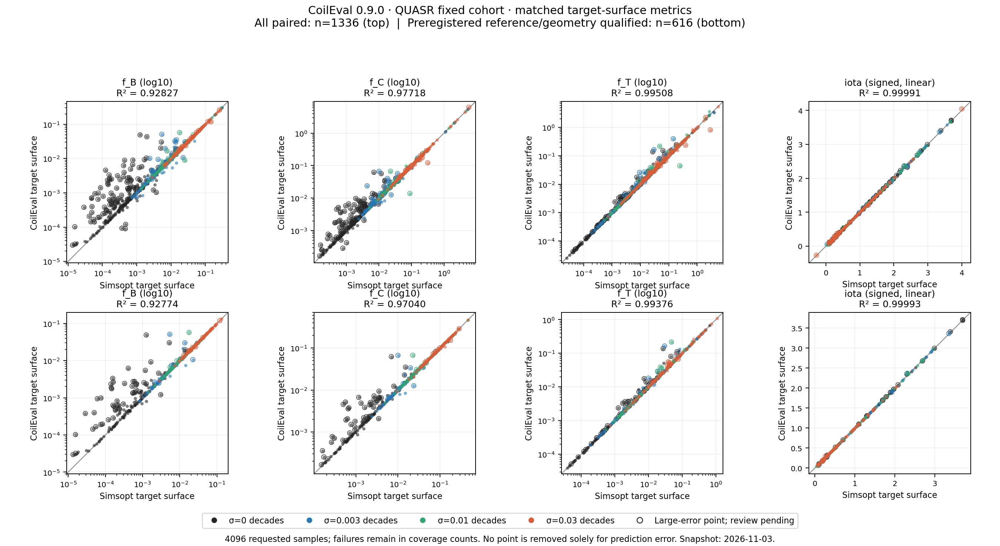

# Preview 验证实验

2026-11-03 验证实验使用冻结安装的 CoilEval 0.9.0，包仍未发布。
实验包含固定 QUASR 精度样本、公开 API 耗时、QA 优化结果的独立重建，以及简单圆环初始化。
各实验 manifest 的源码与库哈希标识实际测量版本。

## 固定精度样本：初步快照

使用种子 `2026110201` 从 371701 条 QUASR 全目录中均匀无放回抽取 1024 个 ID，
不限制线圈数、场周期数和 QS 类型。每个 ID 对应 0、0.003、0.01、0.03 decades
四档扰动，共 4096 个评估任务。每个 Fourier 系数和线圈电流独立乘以
`10**(sigma*z)`，其中 `z` 为标准正态变量，零系数仍为零。
目标体积固定为原始外边界参考体积的一半，源半径倍率为 3.5，初始化采用高精度 `reference` 配置。

基础 GPU 与 CPU 计算已完成，包含明确记录的失败。4096 个请求中，1981 个有完成的
Simsopt 参考，1336 个有 CoilEval/参考配对结果，其中 616 对满足预先声明的参考资格。
下表为 2026-11-03 初步快照，两类统计均保留大误差和待审查样本。
比较采用目标磁面的 iota，以及定义和权重一致的磁面 f_B、f_C、f_T。

| 统计范围 | 配对数 | log₁₀ f_B R² | log₁₀ f_C R² | log₁₀ f_T R² |
| --- | ---: | ---: | ---: | ---: |
| 全部配对 | 1336 | 0.928267 | 0.977176 | 0.995077 |
| 参考资格合格 | 616 | 0.927736 | 0.970397 | 0.993762 |

R² 在 log₁₀ QS 值上按 `1 - sum((prediction-reference)^2) / sum((reference-mean(reference))^2)`
计算，不拟合回归。带符号的目标磁面 iota 使用线性尺度，全部配对的 R² 为 0.99991166、
RMSE 为 0.006556。零噪声档有 385 对，f_B 对数尺度 R² 为 0.744453；
混合噪声统计的整体一致性不能代表零噪声档的精度。

上排展示全部配对，下排展示参考资格合格的配对；QS 坐标为对数尺度，带符号的 iota 为线性尺度。
对角线表示相等，圈出的点仍待审查。另提供 [PDF](assets/preview_validation_20261103/calibration_scatter.pdf)
和[图表溯源记录](assets/preview_validation_20261103/calibration_figure_receipt.json)。

145 个样本仍等待独立庞加莱审查，以检查大误差和可能的岛链附近、细长磁面情况。
基于几何证据的最终筛选尚待完成，没有按误差大小删除样本；失败和剔除样本在 4096 个请求的
统计中保留 ID 与原因。固定原始输入与 Simsopt 参考已冻结可复用；后续版本校验冻结清单，
仅重跑 CoilEval 和分析。协议为
`coileval090-all-quasr-1024-four-noise-matched-surface-20261102-v1`。
原始证据位于上层验证工作区 `evaluation/coileval_preview_20261102/calibration/`：
`config.template.json`、`frozen_inputs/{manifest,selection,input_inventory,delivery}.json`
及 `poincare_execution_20261103/required_reviews.json`。初步统计、4096 行紧凑绘图输入、
分析收据和参考冻结收据分别为
`results_20261103/{summary,paired_metrics,analysis_receipt,freeze_receipt}.json`。

## 公开 API 计时工作量

耗时基准使用八个固定查询。四个 QUASR QH 原始线圈的 ID 为 1916221、2485714、1631665、
1631494，均保留全部 16 阶 Fourier 系数，`nfp=4`、四个基本线圈和 400 个物理参数。
目标体积依次取每个原始参考体积的 0.25 和 0.5，每个查询显式冻结 `EvaluationConfig`。
各批量使用该顺序的前缀。这组样本沿用既有吞吐基准；随机 QUASR 标定实验另行衡量群体精度。

矩阵包含 CPU8、RTX 5090 和 A100，每个分配使用 8 个逻辑 CPU。每种设备记录
标量调用及公开批量 B1、B2、B4、B8，分别测纯求值和完整求值加一次包含工程指标
的标量损失梯度。梯度包括 QS 体积、边界 iota、法向漂移质量、线圈间距、曲率、
长度和表面体积；可选表面 QS 分数作为独立指标。源拟合共享关闭，包括同一线圈的两个目标体积；
GPU 批量磁轴准备和公开接口的流水线保持启用。

每条记录都在新进程中运行。第一次同步公开调用标为 `cold`，一次或多次不计时调用
标为 `warmup`，随后三次同步调用标为 `measured`。计时墙钟包含公开前向、设备完成、
目标函数和梯度模式的一次反传；输入加载、导入、构造、分配、序列化和清理在计时外。
分别报告批量墙钟和墙钟除以批大小；后者是摊销成本，不是标量延迟。

JSON 记录保存源码、原生库、场库、队列、物理数组和配置哈希，以及设备元数据、各次
尝试、状态和错误。缺失或失败单元由归约器明确保留。正式耗时取完整公开调用的同步墙钟。

运行器要求 Slurm 分配，并检查实际 GPU 名称是否符合 RTX 5090 或 A100。CPU 记录会清空
`CUDA_VISIBLE_DEVICES`，并记录 `NUMPY_MADVISE_HUGEPAGE=0`，以避免已知的首次触页混杂。

CPU 分配为 Intel Xeon Gold 6530 上的八个逻辑 CPU，使用八线程和 PyTorch 2.7.1+cpu。
RTX 5090 的主机采用同一 CPU 型号；A100-SXM4-80GB 的主机采用 Intel Xeon Platinum 8358P。
两个 GPU 环境均为 PyTorch 2.7.1+cu128。GPU 局部响应按 0.9.0 API 使用 FP32 磁场运算、
FP64 psi 运算，精度字段保存在原始记录中。该耗时矩阵请求常规体积 `f_C` 指标，
可选的目标磁面 `f_B`、`f_T` 不在本次计时请求内。

每种硬件使用一份独立资源分配；同一分配内的各格通过新进程顺序执行，以免同设备竞争
影响延迟。三种硬件同时运行。时间代表已记录的硬件和工作量；跨硬件比值同时包含主机配置差异。

## 测得耗时

全部 30 格耗时测量于 2026-11-03 完成，每格均在一次冷调用和一次热身后获得三次有效测量，共 90 次测量调用。
CPU 测量已在重试作业 128043 中完成。下表为整次调用的中位耗时，单位秒；批量包含对应行标出的独立查询数。

<!-- BENCHMARK_WALL_TABLE -->

| API 工作量 | CPU8 求值 | CPU8 求值加梯度 | RTX 5090 求值 | RTX 5090 求值加梯度 | A100 求值 | A100 求值加梯度 |
| --- | ---: | ---: | ---: | ---: | ---: | ---: |
| 标量 | 22.483 | 42.531 | 1.553 | 1.959 | 1.903 | 2.473 |
| 批量 1 | 22.865 | 41.871 | 1.560 | 1.989 | 1.898 | 2.452 |
| 批量 2 | 63.821 | 99.577 | 2.584 | 2.813 | 3.219 | 3.650 |
| 批量 4 | 121.086 | 192.466 | 4.665 | 5.029 | 5.902 | 6.620 |
| 批量 8 | 245.300 | 385.934 | 9.013 | 9.420 | 11.282 | 12.657 |

<!-- /BENCHMARK_WALL_TABLE -->

批量 8 的求值/求值加梯度均摊时间，RTX 5090 为 1.127/1.178 秒每查询，
A100 为 1.410/1.582 秒每查询。冷调用和构造耗时另存在原始记录中；上表展示热调用延迟。

协议为 `coileval-preview-public-api-benchmark-20261102-v1`。
上层验证工作区的 `evaluation/coileval_preview_20261102/benchmark/`
保存哈希固定的计划、样本收据、原始 JSON、汇总与审计。CPU 首次尝试因所用环境缺少
`threadpoolctl`，在真正计时前终止；重试复用既有 CPU 环境，首次失败记录仍保留。

## Example 1：QA BFGS 结果的独立参考评估

从满足 `Ap < 9`、DESC 边界 `f_C < 0.01` 的 12 个历史候选中选择
`n3-QA-i0-l5-s2-v5`。冻结配置采用 `nfp=3`、四个基本线圈、QA 螺旋度 `(1,0)`，
选中轨迹为 `w2-t00000182` 的第 397 步。目标函数设定 iota 0.47、线圈间距 0.1 m、
最大曲率 6 m⁻¹、平均线圈长度 3.5 m、体积 0.3 m³。工程目标采用软约束；
选中线圈的实际间距为 0.099124 m、最大曲率 6.109613 m⁻¹、平均长度 3.535930 m。

2026-11-03 完整参考评估已完成 source psi → alpha → nu → 标准 Simsopt 最小二乘/Newton
→ 诊断 → DESC。参考配置采用 FP64、16 阶 Simsopt 磁面，以及 GPU 上的 DESC
`L=M=N=12` 求解，最多 300 步，`ftol=xtol=gtol=1e-10`。

| 量 | 结果 | 定义或范围 |
| --- | ---: | --- |
| 体积等效 Ap | 8.4326 | `R_axis_mean / sqrt(V / (2*pi²*R_axis_mean))`，最终 Simsopt 磁面 |
| 实际磁面体积 | 0.300000011 m³ | 最终 Simsopt 磁面 |
| 目标磁面 iota | 0.469986190 | 最终 Simsopt 磁面 |
| Simsopt 磁面 f_C | 0.008162690 | CoilEval 局部残差定义，磁通壳层 RMS |
| DESC 边界 f_C | 0.007228119 | 表面 Jacobian 加权的 DESC 残差绝对值均值，除以 B₀³ |
| DESC 磁面嵌套 | true | 最终 DESC 嵌套检查 |

两行 f_C 使用不同的聚合与归一化约定。这里的 QA Simsopt f_C 来自上层完整物理流程中
显式支持 helicity 的参考实现；独立 0.9.0 `surface_fc` 函数只提供 QH。
Simsopt 磁面**带质量警告接受进入下游**：
致密网格相对 L2 为 `1.310671e-4`，法向场 p95 为 `1.728808e-4`，
均超过各自严格阈值 `1e-4`。Simsopt 最小二乘和 Newton 均收敛。
DESC 优化器在 63 步后收敛，最终边界保持嵌套；归一化力残差的绝对值均值为 0.004381、
p95 为 0.011211。结果保留 `certified_equilibrium=false`。

## Example 2：简单圆环初始化未进入 BFGS

初始化构造 `nfp=3` 的四个基本极向圆环，大半径为 1 m、圆环半径为 `3.5/(2*pi)` m，
加入有界的中心、倾斜、电流和 2–4 阶 Fourier 扰动。同一组 32 个种子按顺序在
0.30、0.15、0.075 m³ 下筛选，前一档全无有效初始值时才进入下一档。
预定流程选择有效种子中 loss 最小者，随后运行稠密逆 BFGS、一次全链解析反传和
Armijo 纯求值线搜索。损失沿用 Example 1 的 QA 目标，iota 容差为 0.005。

三档筛选均为**零有效初始值**，BFGS 因而没有启动。每档 32 个种子均通过线圈几何检查，
其中 30 个返回 `no_axis`，两个因源区域不满足近轴二次型正定要求而返回 `no_surface`。
这对应 32 个独立种子的 96 次评估。该结果是失败的初始化实验，结论范围限于已声明的几何、扰动和种子。

两个示例的协议为 `coileval-preview-validation-examples-20261102-v1`。
原始证据保存在上层验证工作区 `evaluation/coileval_preview_20261102/examples/`：
`manifest.json`、`selection.json` 和 `execution_20261103.json`；Example 1 原始结果为
`results_20261103/example1/{surface_fc,simsopt_summary,desc_summary,result}.json`；
Example 2 保留 `results_20261103/example2/{summary,result}.json`，以及同一 Example 2
目录内的 `events-v030.jsonl`、`events-v015.jsonl`、`events-v0075.jsonl`。
冻结输入与可运行入口位于上层工作区的 `example1/` 和 `example2/` 目录。
