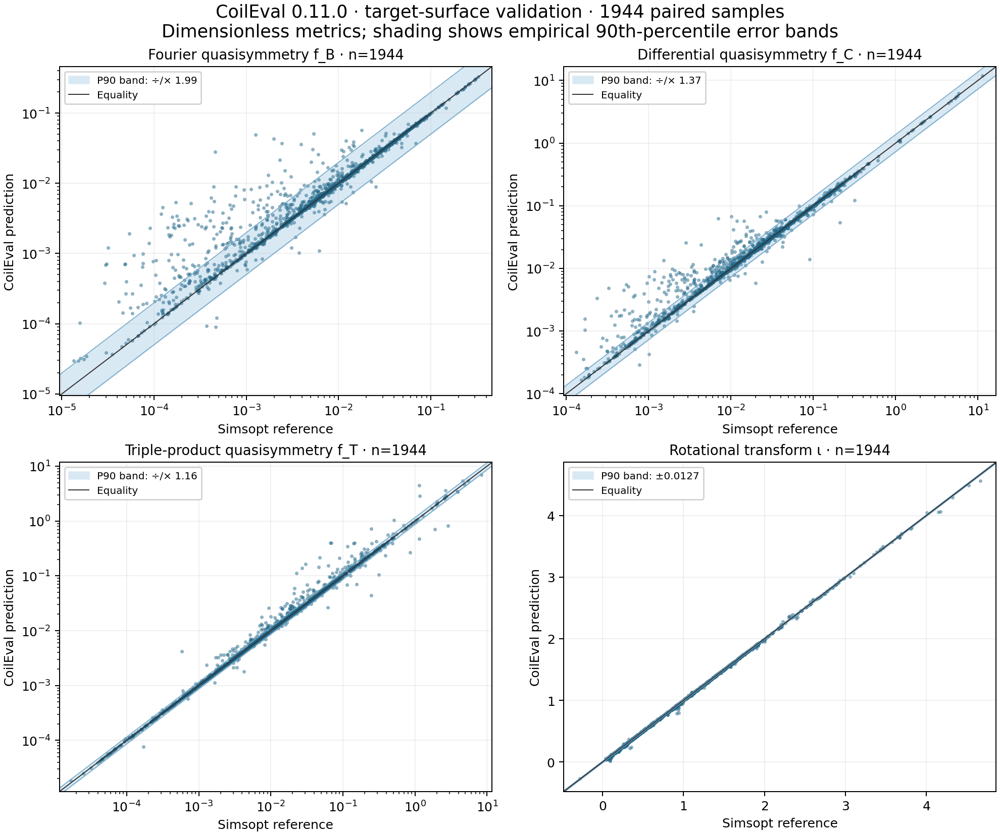
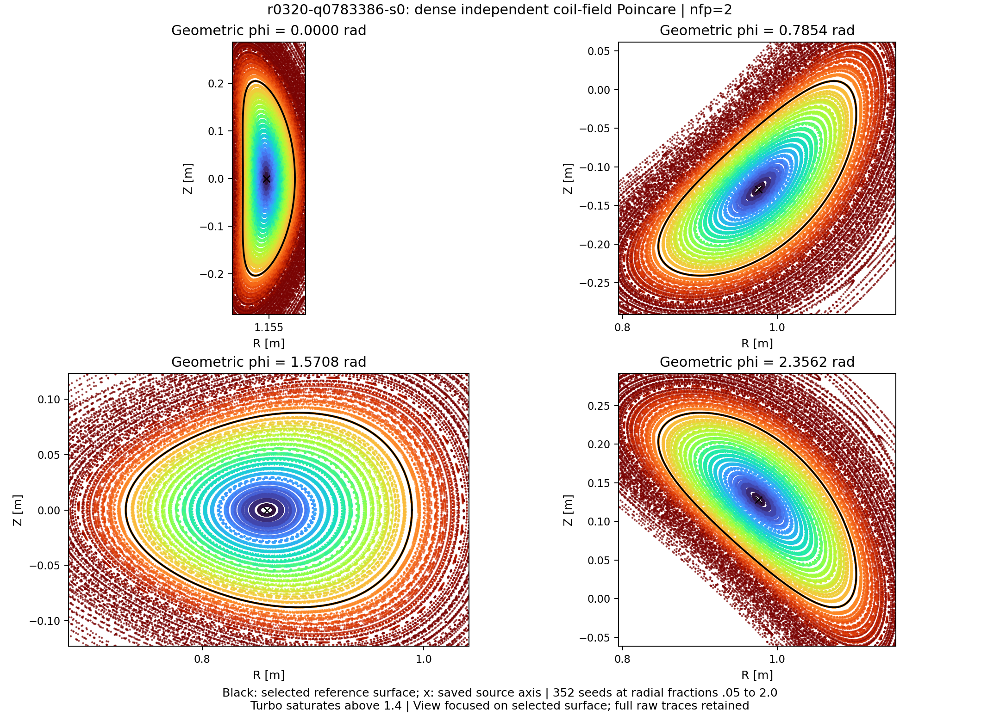
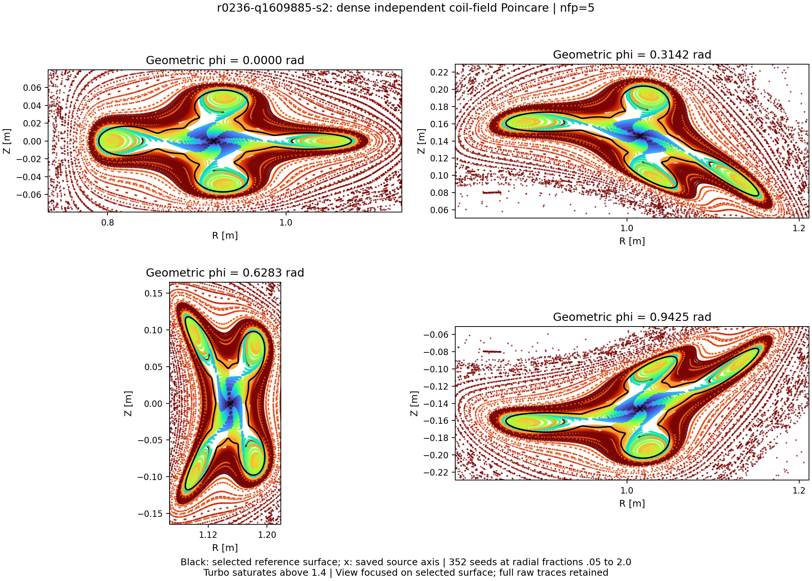
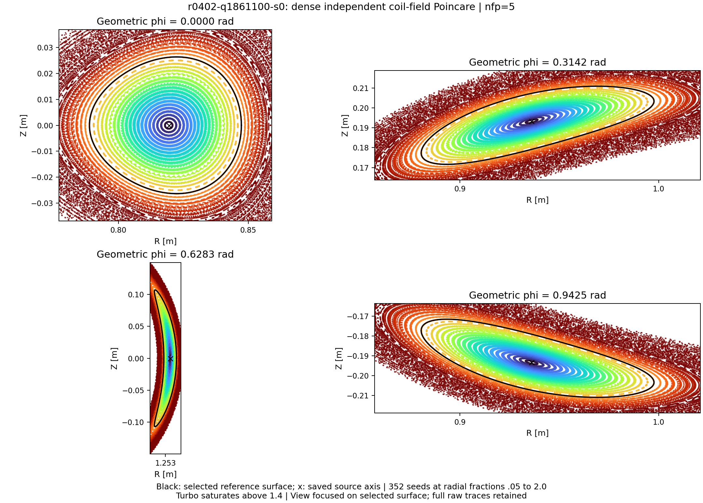

# CoilEval 0.11.0 验证结果与使用边界

**适用范围：** 0.11.1 沿用这里验证的 0.11.0 评分器和默认设置；误差与速度数据继续适用。本文 Example2 记录旧完整目标/优化策略的历史验证。新的简明教学脚本见[示例说明](../examples/README.zh-CN.md)，不应把旧轨迹当成它的运行结果。

[English](preview_validation.md)

CoilEval 根据线圈估计磁面和准对称性指标。本版默认先在初始区域拟合磁面标签函数 s，
再在选出的闭合区域内重新拟合；标签函数的等值面用来近似磁面。
以下报告这套**两次拟合流程**在固定样本集上的误差、运行速度和两个示例。
Simsopt 是独立的磁场与磁面优化库，本次把其已保存的参考解与 CoilEval 的结果逐一比较。
可选的第三次拟合覆盖略大于目标体积的整个内部，默认关闭。

## 精度与速度

本页用语：**准对称性（QS）**指磁场强度在合适的磁面角坐标中只依赖一个螺旋角；
**准轴对称（QA）**和**准螺旋对称（QH）**分别是其中的轴对称型和螺旋型。
`nfp` 是绕装置一周重复的场周期数，`helicity=(M,N)` 指所要求的角组合 `Mθ−Nφ`，
θ 为极向角（绕磁面截面），φ 为环向角（绕整个装置）。**ι（iota，旋转变换）**是磁力线
每绕环向一圈平均绕极向的圈数。**RMS**是先求平方的加权平均、再开平方的均方根；
**P90/P95**分别是第 90/95 百分位数。`f_B` 衡量不符合指定对称性的磁场强度傅里叶分量，
`f_C` 是微分形式的准对称性残差，`f_T` 是包含磁场导数的三重积残差；它们的理想值均为零，
比较时必须使用相同的积分区域和归一化。

固定 1024 个 QUASR 线圈数据库输入、四个噪声尺度，共 **4096** 个任务。默认的两次拟合方法
得到 **2127** 个完整评分；与冻结 Simsopt 参考可配对 **1944** 个，其中 **817** 个满足
原定参考质量门槛。所有大误差点均保留。1981 个完成的参考不重算；无参考样本只计成功率。

图中 QS 条带为 `exp(±P90(|ln(预测/参考)|))`，ι 条带为 `±P90(|预测−参考|)`。
它描述本样本集的误差覆盖范围。QS 全配对的实测倍数依次为 1.986、1.368、1.157；
表格另列易读的相对误差 P90，两者定义不同。

| 样本集 | 数量 | f_B P90 相对误差 | f_C P90 相对误差 | f_T P90 相对误差 | ι P90 绝对误差 |
| --- | ---: | ---: | ---: | ---: | ---: |
| 全部配对 | 1944 | 93.86% | 34.67% | 15.20% | 0.01270 |
| 参考质量合格 | 817 | 87.04% | 30.17% | 12.17% | 0.01015 |

以下全部单位为 **秒/样本**：一次冷调用和一次额外预热后，计时三次完整调用，取中位数，批量调用再除以批大小。
“求值＋梯度”包含完整目标的一次反传。批量均摊耗时反映吞吐，单样本响应延迟见“单点”行。

| 接口 / 指标 | 模式 | CPU 8 线程 | CPU 16 线程 | CPU 32 线程 | RTX 5090 | A100 |
| --- | --- | ---: | ---: | ---: | ---: | ---: |
| 单点 / 体积 f_C | 求值 | 22.922 | 18.195 | 15.938 | 1.775 | 1.911 |
| 单点 / 体积 f_C | 求值＋梯度 | 40.000 | 28.481 | 21.838 | 2.168 | 2.397 |
| 批量 1 / 体积 f_C | 求值 | 22.843 | 20.695 | 15.847 | 1.785 | 1.915 |
| 批量 1 / 体积 f_C | 求值＋梯度 | 42.364 | 29.731 | 22.055 | 2.159 | 2.410 |
| 批量 2 / 体积 f_C | 求值 | 31.186 | 29.588 | 20.676 | 1.502 | 1.606 |
| 批量 2 / 体积 f_C | 求值＋梯度 | 50.412 | 38.103 | 26.830 | 1.572 | 1.823 |
| 批量 4 / 体积 f_C | 求值 | 30.449 | 25.305 | 19.715 | 1.347 | 1.453 |
| 批量 4 / 体积 f_C | 求值＋梯度 | 47.093 | 33.554 | 25.651 | 1.418 | 1.633 |
| 批量 8 / 体积 f_C | 求值 | 30.669 | 24.617 | 19.702 | 1.296 | 1.396 |
| 批量 8 / 体积 f_C | 求值＋梯度 | 47.288 | 49.192 | 34.473 | 1.375 | 1.547 |
| 单点 / 磁面 f_T | 求值 | 36.701 | 28.010 | 26.115 | 2.024 | 2.057 |
| 单点 / 磁面 f_T | 求值＋梯度 | 56.714 | 40.632 | 34.375 | 2.585 | 2.584 |

CPU 8 线程与 GPU 数据实测于 2026-11-05，CPU 16/32 线程补测于 2026-11-06；数值配置、输入和计算库一致。
CPU 三档均使用 Xeon Gold 6530 的逻辑线程，GPU 每项分配八个主机线程。四组保留到 16 阶的傅里叶线圈形成八个固定查询。
测试使用调度器分配的 CPU，未独占整机；增加线程不保证每项都加速，表中保留全部实测结果。体积 f_C 和附加目标面 f_T 分开列出；
冷启动、整批总时间、硬件及哈希保留在[计时原始证据](assets/preview_s2_20261105/timings.json)。
样本定义、失败分母、参考质量与数值限制见[完整验证记录](preview_validation.zh-CN.md)。

## 样本和误差怎样定义

随机种子 2026110201 从 QUASR 数据库的 371701 条配置中均匀无放回抽取 1024 条，涵盖不同线圈数、场周期数和对称类型。
每条配置产生四个输入：几何系数和电流分别独立乘 `10**(sigma*z)`，z 为标准高斯随机数，
sigma 为 0、0.003、0.01、0.03，单位是十进制对数。目标体积取已保存最外参考体积的一半；
初始拟合半径为 `3.5*sqrt(V_outer/(2*pi²*R_outer))`，其中 V_outer 是所存最外参考面的体积，R_outer 是该面的平均柱坐标半径，长度均以米计。此扰动与示例 2 的 ln(1.01) 对数扰动不同。

4096 个输入全部保留。参考求解有 1981 个完成、181 个拒绝、16 个超时，另有 1918 个因原评估失败而未获得参考。
本版得到 2127 个完整评分，另外 1674 个在基础求值中失败、240 个在构造保存的拟合记录时失败、55 个在目标磁面指标计算中失败。
1944 个评分具有完成的参考可用于误差比较；另外 183 个只计入可用率。

表中的 817 个“参考质量合格”样本还满足以下预先设定的参考规则，未依据 CoilEval 的误差筛选：

- Simsopt 求解通过有限值、体积、角向覆盖等基本检查；在加密网格上，Boozer 方程相对 L2 残差和 `|B·n|/|B|` 的 P95 均不超过 1e-5，n 为单位法向量；采样截面的自交检查已完成且未检出自交。
- 截面可解析，最大协方差轴比不超过 5。轴比是沿边界弧长加权的点云协方差最大、最小特征值之比的平方根，衡量形状细长程度。
- 目标旋转变换与分母不超过 8 的有理数相距至少 0.01。接近有理数可能使角方程敏感，本身不证明存在岛链。
- 角向网格从 97 增至 129 时，三项 QS 变化满足绝对 1e-10 加相对 2% 的容差。
- 每条线圈的积分点数从 512 增至 1024 时，磁场向量相对 L2 误差不超过 1e-3。L2 是欧氏范数，分母取参考向量的范数。

参考磁面的角向傅里叶阶数固定为 16，尚未通过提高磁面阶数建立收敛证据。
本次沿用所有已完成参考，未补算、替换或按误差移除样本。

三项 QS 在两边使用相同的指标公式。Boozer 坐标是一种使磁力线为直线、且磁场协变角分量只随磁面变化的角坐标。
f_B 是非对称傅里叶能量占比的平方根；f_C 和 f_T 在相邻等磁通面之间的薄壳上，以 `|G|/B²` 加权求 RMS。
这里 B 为磁场强度、G 为磁场的环向协变分量；三重积 `T=(∇ψ×∇|B|)·∇(B·∇|B|)` 使用 `R²*T/B⁴` 无量纲化，ψ 是环向磁通除以 2π，R 为平均磁轴大半径。
螺旋度对每个样本显式设置。散点中的 ι 从目标磁面重新求角坐标得到；API 的 `iota_boundary` 则来自整个体积的角拟合。
二者对应不同拟合，比较时应保留名称。

P90 为线性插值的第 90 百分位数。QS 图带按 `P90(|ln(预测/参考)|)` 给出正反对称倍数；
表格按 `P90(|预测/参考−1|)` 计算相对误差。ι 用绝对差。
这些是固定样本的经验覆盖范围，不是置信区间；四档合并统计也不能代替零噪声样本的单独统计。

[全部 4096 行](assets/preview_s2_20261105/calibration_rows.json)、[统计与来源摘要](assets/preview_s2_20261105/accuracy.json)、
[四图 PDF](assets/preview_s2_20261105/calibration_p90.pdf)随文档提供。
参考文件清单 SHA256 为 `daff50895c551b855adbd92aa9b8e75399f2bc1dd8288c74a432d4d96eee3248`，用于核对参考是否保持一致。

## 大误差与失败的已知原因

本版包含角坐标反解和径向求根修复。角反解由指定角度寻找空间位置；径向求根从磁轴向外寻找标签函数的等值面。
评估器要求使用与磁轴相连的第一段单调径向区间，称为首支；其可表示的最大体积称为容量。
拟合标签向外转向时会失去容量，这不直接说明真实磁场不存在磁面。

光滑、嵌套的庞加莱截面也可能对应较大 QS 误差。已确认的原因包括：整个体积的拟合目标与正则惩罚偏好某些标签函数，
让小的磁面几何误差盖过目标本来很小的 QS；角方程未保留的高频傅里叶分量影响已保留分量；
接近共振时，求角修正所除的 `m*ι−n*nfp` 很小，从而放大输入几何和磁场误差；这里 m 是极向傅里叶模数，n 是每场周期的环向模数。
正则化是在最小二乘目标里加入系数惩罚，降低它并不总能改善结果。

另有曲面不能由每条从磁轴出发的射线上的单个交点表示，或者不满足全局光滑角坐标的假设。
这些限制与拟合误差需要分别判断；仅看截面或拟合残差不足以保证 QS 精度。

可选第三次拟合同时改变内部训练范围和正则强度。在相同 4096 输入中，它得到 1821 个评分；
相对默认流程丢失 314 个、恢复 8 个。范围和正则各有作用，也存在交互，因此 `psi_target_refit=False` 保持默认。
本版仍先做体积角拟合；目标面另以几何和磁场独立求角坐标，极向/环向傅里叶阶数均为 32。

## 耗时测量范围

固定八个查询来自四组傅里叶阶数为 16 的准螺旋对称线圈，编号 1916221、2485714、1631665、1631494，
每组分别评估所存参考体积的 0.25 和 0.5 倍。单点调用和批量 1/2/4/8 的体积 f_C，以及单点目标面 f_T，
各测求值、求值加梯度两种模式。每个查询独立拟合；GPU 保留批量磁轴准备和 CPU/GPU 阶段重叠。
磁场局部响应采用 FP32（32 位单精度），标量代数采用 FP64（64 位双精度）。

每项测试使用新进程：记录一次冷调用，额外预热一次，再计时三次。计时包含完整公开调用；梯度模式还包含
完整目标函数的一次反向求导，含线圈几何条件。导入、构造、序列化和清理在计时外。GPU 在计时两端同步。
CPU 使用 Xeon Gold 6530 和 PyTorch 2.7.1+cpu；GPU 使用 PyTorch 2.7.1+cu128，RTX 5090 的主机为 Gold 6530，
A100 的主机为 Platinum 8358P。批量耗时除以样本数后列入表格，单点行可用于估计单次响应时间。
该固定工作量的速度不代表随机标定样本的耗时分布。

## 示例 1：固定线圈

使用 [example1.json](../examples/preview/example1.json)，目标体积 0.3 m³、拟合半径 √0.06 m，先用本版重新评分，
再构造角坐标初值，用 Simsopt 做最小二乘和 Newton 磁面精修，最后用 DESC 求解固定边界磁流体平衡。
DESC 是独立的平衡求解库，本次使用 12 阶展开、最多 300 次迭代。

新体积 f_C 为 0.0039104499，体积角拟合的边界 ι 为 0.46571541；DESC 边界 f_C 为 0.0072281188。
DESC 指标采用其面积加权平均绝对残差及归一化，CoilEval 体积指标采用 RMS，二者应分别解读。
DESC 在 63 次迭代后达到目标梯度停止容差 `gtol`；初始和最终拟合面嵌套。
归一化残余力均值/P95/最大值为 0.00438092/0.01121054/0.08626663，严格平衡认证仍为 false。

[求值结果](assets/preview_s2_20261105/example1_native.json)、[输入与代码身份](assets/preview_s2_20261105/example1_source_provenance.json)、
[完整阶段记录](assets/preview_s2_20261105/example1_result.json)可供复核。

## 示例 2：扰动、筛选和优化

运行入口和完整命令见[示例 2 指南](../examples/preview/README.zh-CN.md)。每个几何系数独立乘 `exp(ln(1.01)*z)`，
固定种子 2026110502，筛选时电流不变。32 个候选中 25 个有效，编号 4 的完整目标最小。
目标合并 QS、旋转变换、间距、曲率、长度、体积、法向漂移和磁轴半径成本。

BFGS 用梯度更新逆曲率近似；Powell 阻尼稳定更新，Armijo 回溯缩短试探步直到目标充分下降。
400 次外迭代预算内，实际 164 次迭代接受 116 次更新，因连续拒绝试探点而停止。
最优记录位于第 132 次迭代，目标从 −3.69036229 降到 −5.48909363，体积 f_C 从 0.0178609147 降到 0.0038968281。
1% 扰动完成流程，无须缩小噪声；停止原因不等于收敛证明。

最终线圈也完成上述独立参考流程。DESC 在 110 次迭代达到 gtol，初始/最终拟合面嵌套，边界 f_C=0.0075078856。
归一化残余力均值/P95/最大值为 0.00561424/0.01405266/0.14672194，严格平衡认证仍为 false。
新完整求值的体积 f_C=0.0038968455，与优化记录相对相差 4.47e-6，分别保留原记录。
[优化记录](assets/preview_s2_20261105/example2_optimization.json)、[新求值](assets/preview_s2_20261105/example2_native.json)、
[完整物理结果](assets/preview_s2_20261105/example2_result.json)提供状态和停止原因。

两例各用 352 个起点独立追踪磁力线，四个固定环向截面的交点构成庞加莱图。
所选边界附近可见岛状轮廓，外层轨迹有散开；未逐个认证周期轨道。
DESC 拟合面的嵌套不等于原线圈磁场具有全局嵌套磁面。

## 庞加莱图中的几何检查

早期异常检查在目标面附近的 0.9、1.0、1.1 倍径向位置各设 8 个起点，仅用于局部诊断。
QS 相差超过两倍，或 ι 绝对误差超过 `max(0.01,0.02*|参考ι|)` 的样本进入检查队列，仍保留在主统计中。
岛链标签要求解析出分离的闭合瓣；细长标签要求协方差轴比超过 5；覆盖不足仍标为无法判断。

下面的概览图另用 352 个起点：参考边界 32 个，另在 8 条射线上取 40 个 0.05–2.0 的径向比例。
双精度追踪 256 个场周期，每周期 256 个 Runge–Kutta 积分步，每条线圈离散 512 段。
四幅截面图保持 R/Z 物理比例一致；R 为柱坐标半径，Z 为高度，单位米。
黑线为参考边界，叉号为磁轴，颜色表示起点径向比例。视窗聚焦边界及外侧 20% 范围，原始轨迹均保留。

编号 `r0320-q0783386-s0` 的 352 条线均完成追踪，目标附近连续嵌套，但 f_B 约为参考的 13.1 倍。
控制实验确认拟合目标和正则偏置是主要原因；该样本仍保留在两组误差统计中。
[图来源](assets/preview_validation_20261103/poincare_dense_r0320-q0783386-s0.provenance.json)。

编号 `r0236-q1609885-s2` 可见多个分离岛瓣，330 条线完成、22 条离开诊断边界。
参考同时有有理数邻近和残差质量警告，不能仅根据岛链归因全部指标误差。
[图来源](assets/preview_validation_20261103/poincare_dense_r0236-q1609885-s2.provenance.json)。

编号 `r0402-q1861100-s0` 的最细长截面协方差轴比为 5.907882，超过阈值 5；352 条线全部完成。
嵌套轮廓与细长几何可以同时出现。[图来源](assets/preview_validation_20261103/poincare_dense_r0402-q1861100-s0.provenance.json)。

相同线圈离散下，32 个点的独立磁场比较相对 L2 小于 6e-16。
另以 24 个起点追踪 32 个周期，分别加倍积分步和线圈段数；岛链例积分加密的共同有限点差值最大 0.246551 m、P95 为 4.38e-9 m，
说明个别外层轨迹对积分精度敏感。有限追踪不构成全局拓扑认证。各图附带的来源文件记录追踪配置与原始证据位置。
